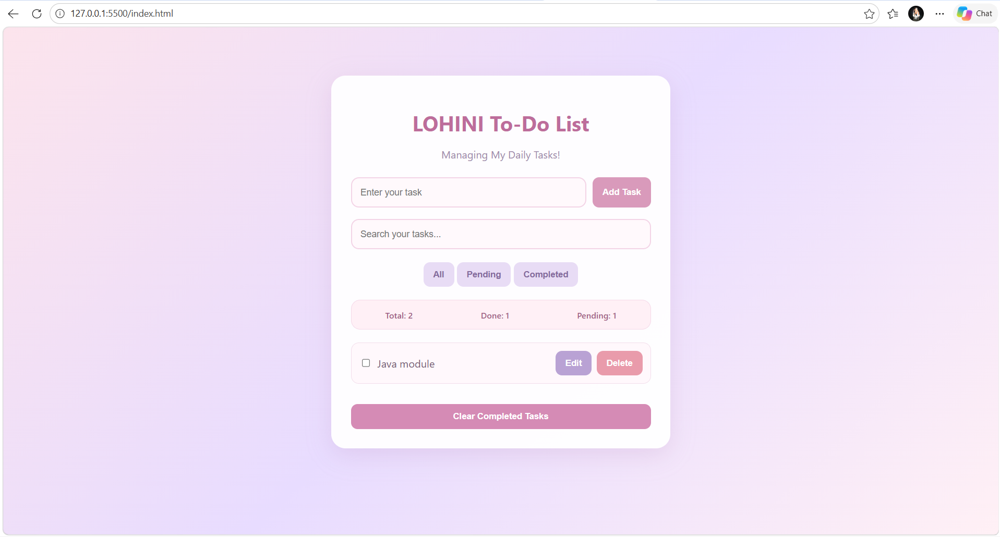
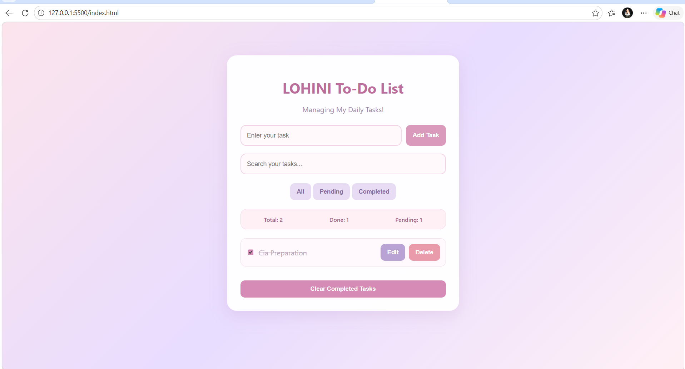

# To_Do_List
# Ex03 To-Do List using JavaScript
## Date: 17.11.2026

## AIM
To create a To-do Application with all features using JavaScript.

## ALGORITHM
### STEP 1
Build the HTML structure (index.html).

### STEP 2
Style the App (style.css).

### STEP 3
Plan the features the To-Do App should have.

### STEP 4
Create a To-do application using Javascript.

### STEP 5
Add functionalities.

### STEP 6
Test the App.

### STEP 7
Open the HTML file in a browser to check layout and functionality.

### STEP 8
Fix styling issues and refine content placement.

### STEP 9
Deploy the website.

### STEP 10
Upload to GitHub Pages for free hosting.

## PROGRAM


## OUTPUT


## RESULT
The program for creating To-do list using JavaScript is executed successfully.

### STEP 3
Plan the features the To-Do App should have.

### STEP 4
Create a To-do application using Javascript.

### STEP 5
Add functionalities.

### STEP 6
Test the App.

### STEP 7
Open the HTML file in a browser to check layout and functionality.

### STEP 8
Fix styling issues and refine content placement.

### STEP 9
Deploy the website.

### STEP 10
Upload to GitHub Pages for free hosting.

## PROGRAM
#index.html

```
<!DOCTYPE html>
<html>
<head>
    <title>My To-Do List</title>
    <link rel="stylesheet" href="style.css">
</head>
<body>

    <div class="container">

        <h1>LOHINI To-Do List</h1>
        <p>Managing My Works!</p>

        <form id="taskForm">
            <input type="text" id="taskInput"
                placeholder="Enter your task">
            <button type="submit">Add Task</button>
        </form>

        <input type="text" id="search"
            placeholder="Search your tasks...">

        <div class="filters">
            <button type="button" data-filter="all">All</button>
            <button type="button" data-filter="pending">Pending</button>
            <button type="button" data-filter="completed">Completed</button>
        </div>

        <div class="stats">
            <p>Total: <span id="total">0</span></p>
            <p>Done: <span id="done">0</span></p>
            <p>Pending: <span id="pending">0</span></p>
        </div>

        <ul id="taskList"></ul>

        <button type="button" class="clear" id="clear">
            Clear Completed Tasks
        </button>

    </div>

    <script src="script.js"></script>

</body>
</html>
```

#style.css

```
* {
    box-sizing: border-box;
}

body {
    font-family: 'Segoe UI', Arial, sans-serif;
    background: linear-gradient(135deg, #fce4ec, #e8dcff, #fff0f5);
    min-height: 100vh;
    margin: 0;
    padding: 35px 15px;
}

.container {
    background: rgba(255, 255, 255, 0.95);
    max-width: 520px;
    margin: 40px auto;
    padding: 30px;
    border-radius: 22px;
    box-shadow: 0 10px 35px rgba(180, 130, 180, 0.2);
    text-align: center;
}

h1 {
    color: #bd6d9b;
    font-size: 32px;
    margin-bottom: 8px;
}

.container > p {
    color: #a18aab;
    margin-bottom: 25px;
}

form {
    display: flex;
    gap: 10px;
}

input[type="text"] {
    flex: 1;
    min-width: 0;
    padding: 13px;
    border: 2px solid #f3d4e6;
    border-radius: 12px;
    outline: none;
    background: #fff9fc;
    color: #684d66;
    font-size: 14px;
}

input:focus {
    border-color: #d8a5d5;
}

button {
    padding: 11px 15px;
    border: none;
    border-radius: 10px;
    background: #d99abb;
    color: white;
    font-weight: 600;
    cursor: pointer;
    transition: 0.3s;
}

button:hover {
    background: #bd7da6;
    transform: translateY(-2px);
}

#search {
    width: 100%;
    margin-top: 18px;
}

.filters {
    margin: 20px 0;
}

.filters button {
    background: #e8dcf5;
    color: #856b9d;
}

.filters button:hover {
    background: #cdb4db;
    color: white;
}

.stats {
    display: flex;
    justify-content: space-around;
    background: #fff0f6;
    border: 1px solid #f5d8e8;
    border-radius: 14px;
    color: #a45f87;
    font-size: 13px;
    font-weight: 600;
    margin: 20px 0;
}

ul {
    padding: 0;
    list-style: none;
}

li {
    display: flex;
    align-items: center;
    gap: 8px;
    background: #fff8fc;
    border: 1px solid #f2ddeb;
    padding: 12px;
    margin: 10px 0;
    border-radius: 12px;
}

li span {
    flex: 1;
    text-align: left;
    color: #765c75;
    overflow-wrap: anywhere;
}

li input[type="checkbox"] {
    accent-color: #d58bb5;
    cursor: pointer;
}

.completed {
    text-decoration: line-through;
    color: #b8a8b8;
}

.edit {
    background: #b9a2d4;
}

.edit:hover {
    background: #9879bb;
}

.delete {
    background: #e99bab;
}

.delete:hover {
    background: #d66e89;
}

.clear {
    background: #d58bb5;
    margin-top: 15px;
    width: 100%;
}

.empty {
    justify-content: center;
    color: #b69ab5;
    padding: 20px;
    border: 1px dashed #e5c4dc;
}

@media (max-width: 480px) {
    .container {
        padding: 20px;
        margin: 15px auto;
    }

    h1 {
        font-size: 26px;
    }

    li {
        flex-wrap: wrap;
    }
}
```

#script.js

```
let tasks = [];

try {
    tasks = JSON.parse(localStorage.getItem("myTasks")) || [];
    if (!Array.isArray(tasks)) tasks = [];
} catch (error) {
    tasks = [];
}

let currentFilter = "all";

const taskInput = document.getElementById("taskInput");
const taskList = document.getElementById("taskList");
const search = document.getElementById("search");

function saveTasks() {
    localStorage.setItem("myTasks", JSON.stringify(tasks));
}

function addTask(event) {
    event.preventDefault();

    let value = taskInput.value.trim();

    if (value === "") {
        alert("Please enter a task!");
        return;
    }

    tasks.push({
        id: Date.now() + Math.random(),
        text: value,
        completed: false
    });

    taskInput.value = "";

    saveTasks();
    displayTasks();
}

function displayTasks() {

    taskList.innerHTML = "";

    let searchText = search.value.toLowerCase();

    let filteredTasks = tasks.filter(function(task) {

        let matchesSearch =
            task.text.toLowerCase().includes(searchText);

        let matchesFilter =
            currentFilter === "all" ||
            (currentFilter === "pending" && !task.completed) ||
            (currentFilter === "completed" && task.completed);

        return matchesSearch && matchesFilter;
    });

    if (filteredTasks.length === 0) {
        let message = document.createElement("li");
        message.className = "empty";
        message.textContent = "No tasks found!";
        taskList.appendChild(message);
    }

    filteredTasks.forEach(function(task) {

        let li = document.createElement("li");

        let checkbox = document.createElement("input");
        checkbox.type = "checkbox";
        checkbox.checked = task.completed;

        checkbox.addEventListener("change", function() {
            task.completed = checkbox.checked;
            saveTasks();
            displayTasks();
        });

        let span = document.createElement("span");
        span.textContent = task.text;

        if (task.completed) {
            span.classList.add("completed");
        }

        let editButton = document.createElement("button");
        editButton.textContent = "Edit";
        editButton.className = "edit";

        editButton.addEventListener("click", function() {

            let newTask = prompt("Edit your task:", task.text);

            if (newTask !== null && newTask.trim() !== "") {
                task.text = newTask.trim();
                saveTasks();
                displayTasks();
            }
        });

        let deleteButton = document.createElement("button");
        deleteButton.textContent = "Delete";
        deleteButton.className = "delete";

        deleteButton.addEventListener("click", function() {

            tasks = tasks.filter(function(t) {
                return t.id !== task.id;
            });

            saveTasks();
            displayTasks();
        });

        li.appendChild(checkbox);
        li.appendChild(span);
        li.appendChild(editButton);
        li.appendChild(deleteButton);

        taskList.appendChild(li);
    });

    document.getElementById("total").textContent = tasks.length;

    document.getElementById("done").textContent =
        tasks.filter(t => t.completed).length;

    document.getElementById("pending").textContent =
        tasks.filter(t => !t.completed).length;
}

document.getElementById("taskForm")
    .addEventListener("submit", addTask);

search.addEventListener("input", displayTasks);

document.querySelectorAll(".filters button")
    .forEach(function(button) {

        button.addEventListener("click", function() {
            currentFilter = button.dataset.filter;
            displayTasks();
        });
    });

document.getElementById("clear")
    .addEventListener("click", function() {

        if (confirm("Delete all completed tasks?")) {
            tasks = tasks.filter(t => !t.completed);
            saveTasks();
            displayTasks();
        }
    });

displayTasks();
```

## OUTPUT




## RESULT
The program for creating To-do list using JavaScript is executed successfully.